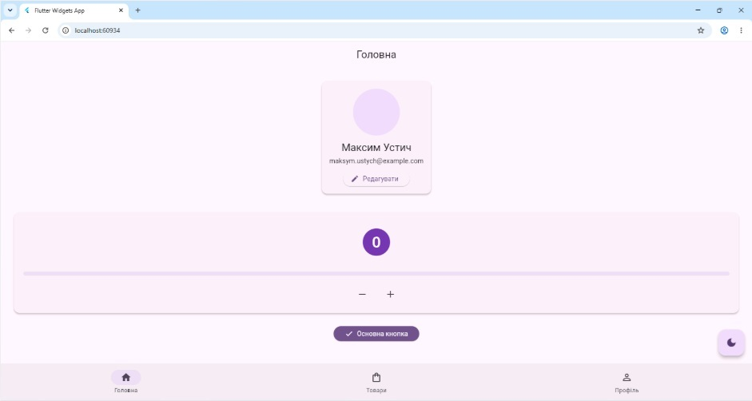
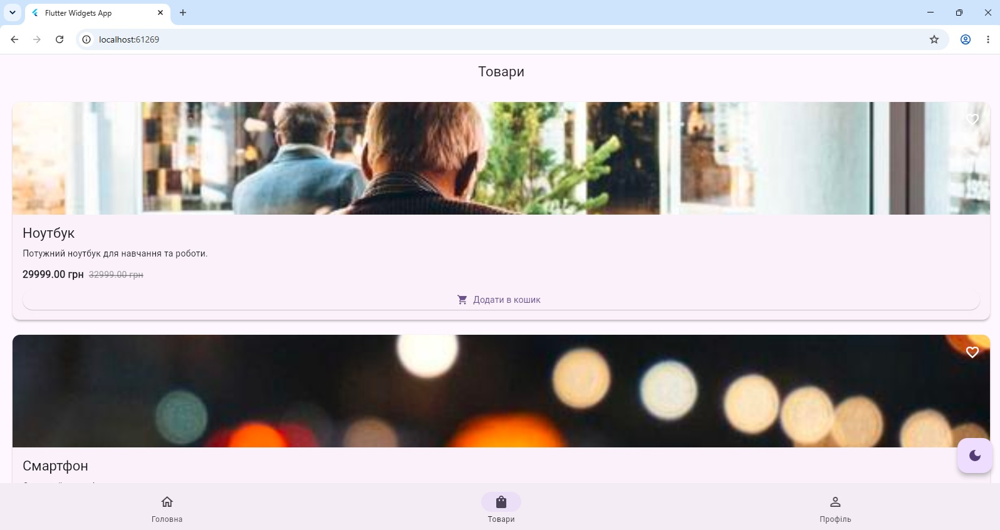
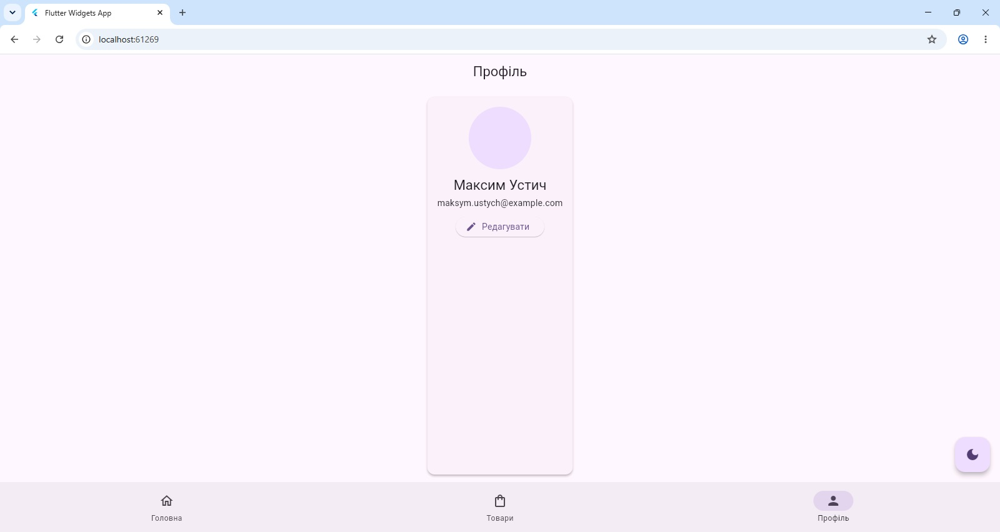
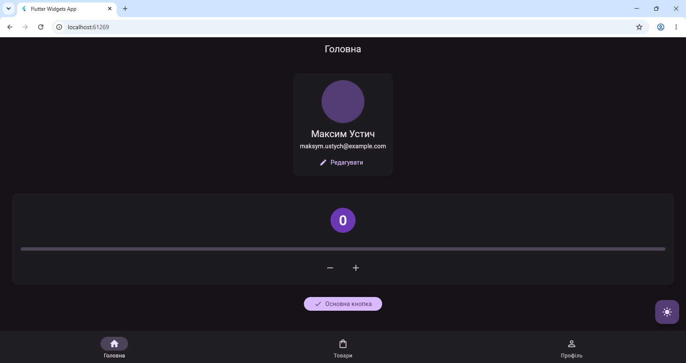
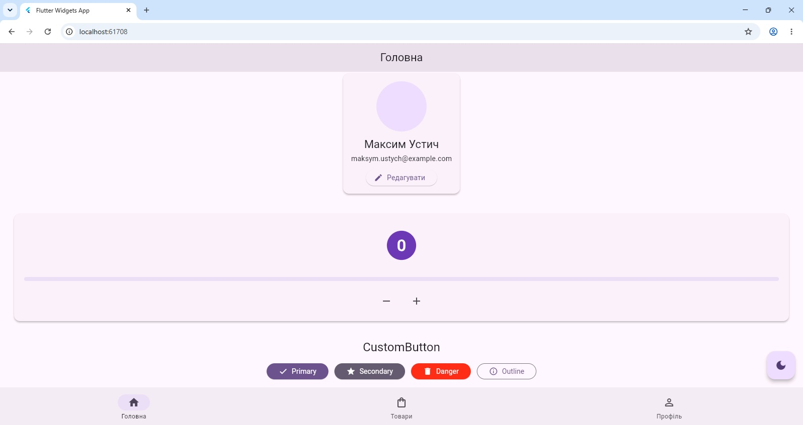
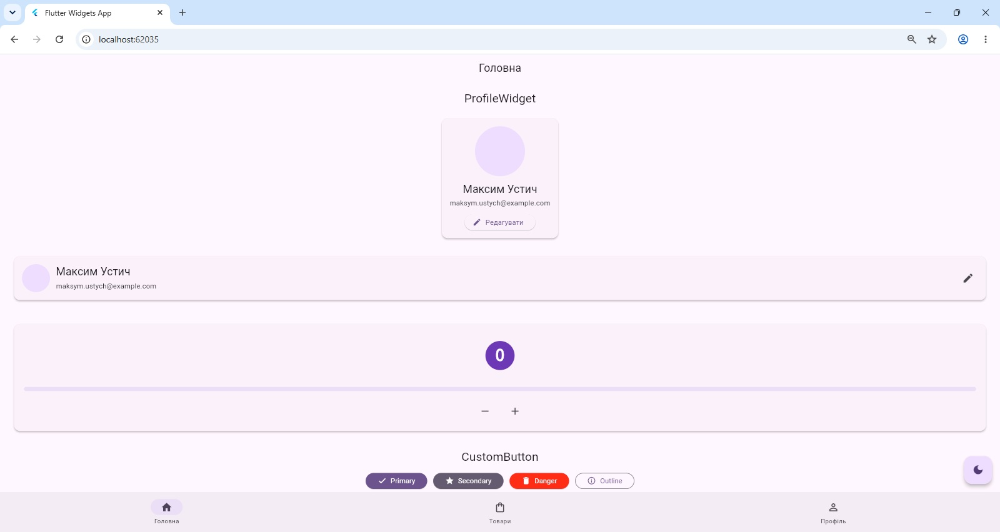
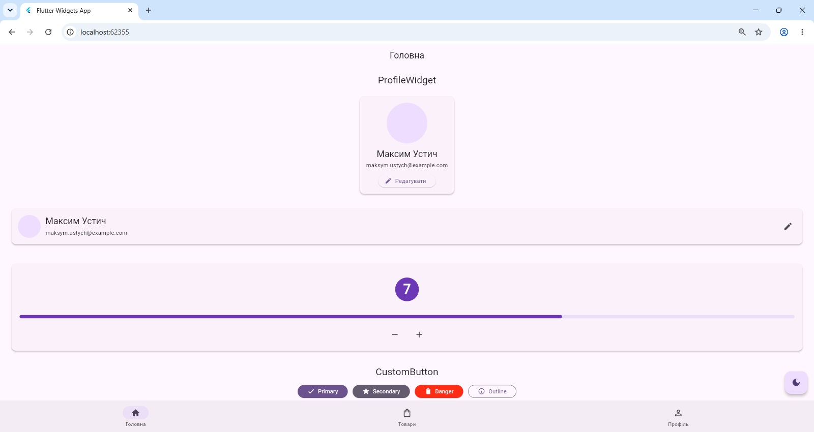
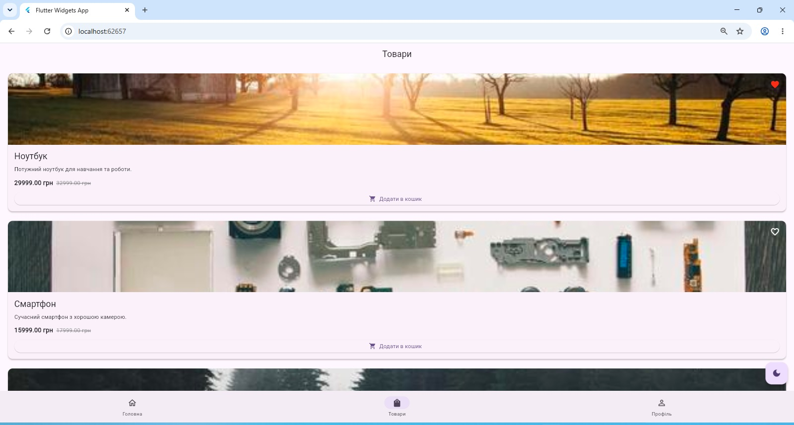

# Flutter Widgets App

Практична робота №5 з дисципліни «Програмування для мобільних платформ».

Студент: Максим Устич

## Опис проєкту

Навчальний Flutter-застосунок для демонстрації роботи з власними віджетами, StatefulWidget, анімаціями, темами та керуванням станом.

## Реалізовані віджети

- ProfileWidget
- CustomButton
- AnimatedCounter
- ProductCard

## Функціональність

- головний екран
- екран товарів
- екран профілю
- світла і темна тема
- анімований лічильник
- додавання товарів в улюблені
- додавання товарів у кошик
- адаптивне відображення у Flutter Web

## Структура проєкту

```text
lib/
├── main.dart
├── screens/
│   ├── home_screen.dart
│   ├── profile_screen.dart
│   └── products_screen.dart
├── widgets/
│   ├── custom_button.dart
│   ├── product_card.dart
│   ├── profile_widget.dart
│   └── animated_counter.dart
├── models/
│   ├── user.dart
│   └── product.dart
└── utils/
    ├── app_state.dart
    ├── constants.dart
    └── themes.dart
```

## Запуск проєкту

```bash
flutter pub get
flutter run -d chrome
```

## Перевірка проєкту

```bash
flutter analyze
flutter test
```

## Скриншоти

### Головний екран



### Товари



### Профіль



### Темна тема



### Варіанти CustomButton



### ProfileWidget: expanded і compact



### AnimatedCounter



### ProductCard: взаємодія з товаром



## Архітектура

Документація архітектури, State Flow, Widget Tree та Mock API Contract:

[Переглянути Architecture Documentation](docs/architecture.md)

## Тестування

Автоматичні тести:
- 12 тестів — успішно
- `flutter analyze` — No issues found
- Test coverage — 72.7%

[Переглянути Test Coverage Report](docs/coverage.md)
