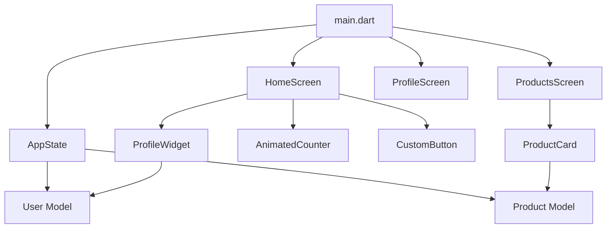
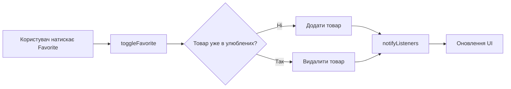
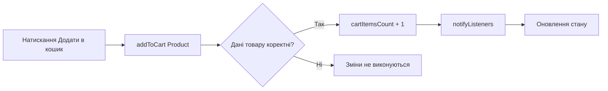

# Architecture Documentation

## 1. Загальна архітектура

Застосунок побудований на Flutter та використовує компонентний підхід.

Основні частини:

- `models` — моделі даних користувача та товару;
- `widgets` — повторно використовувані custom widgets;
- `screens` — основні екрани застосунку;
- `utils` — теми, константи та керування станом;
- `AppState` — централізований стан застосунку.

## 2. Архітектурна схема



## 3. Widget Tree

```text
MyApp
└── MaterialApp
    └── Scaffold
        ├── HomeScreen
        │   ├── ProfileWidget
        │   ├── AnimatedCounter
        │   └── CustomButton
        │
        ├── ProductsScreen
        │   └── ProductCard
        │
        └── ProfileScreen
            └── ProfileWidget
```

## 4. State Management

Для керування глобальним станом використовується клас:

```text
AppState extends ChangeNotifier
```

Він відповідає за:

- поточного користувача;
- список улюблених товарів;
- кількість товарів у кошику;
- оновлення профілю;
- додавання та видалення товарів з улюблених;
- додавання товарів у кошик.

Після зміни даних викликається:

```dart
notifyListeners();
```

## 5. State Flow: Favorite Product



## 6. State Flow: Add to Cart



## 7. Models

### User

Модель `User` містить:

- name;
- email;
- avatarUrl.

### Product

Модель `Product` містить:

- name;
- description;
- price;
- originalPrice;
- imageUrl;
- isFavorite.

## 8. Custom Widgets

### ProfileWidget

Відображає:

- avatar;
- ім'я;
- email;
- expanded режим;
- compact режим.

### CustomButton

Підтримує стилі:

- primary;
- secondary;
- danger;
- outline.

Також підтримує:

- icon;
- loading state;
- callback `onPressed`.

### AnimatedCounter

Реалізує:

- збільшення і зменшення значення;
- scale animation;
- bounce animation;
- зміну кольору при максимальному значенні;
- progress indicator.

### ProductCard

Реалізує:

- інформацію про товар;
- favorite/unfavorite;
- додавання до кошика;
- swipe interaction;
- tap animation;
- image zoom;
- shimmer loading effect.

## 9. Mock API Contract

У поточній версії застосунку використовуються локальні тестові дані.

Можливий API для товарів:

```http
GET /api/products
```

Приклад відповіді:

```json
[
  {
    "name": "Ноутбук",
    "description": "Потужний ноутбук для навчання та роботи.",
    "price": 29999,
    "originalPrice": 32999,
    "imageUrl": "https://example.com/laptop.jpg",
    "isFavorite": false
  }
]
```

Можливий API користувача:

```http
GET /api/user
```

Приклад відповіді:

```json
{
  "name": "Максим Устич",
  "email": "maksym.ustych@example.com",
  "avatarUrl": "https://example.com/avatar.jpg"
}
```

## 10. Separation of Concerns

У проєкті відповідальність розділена:

- UI екрани знаходяться в `screens`;
- reusable компоненти — у `widgets`;
- моделі — у `models`;
- керування станом та теми — у `utils`.

Такий підхід спрощує підтримку, тестування та подальше розширення застосунку.